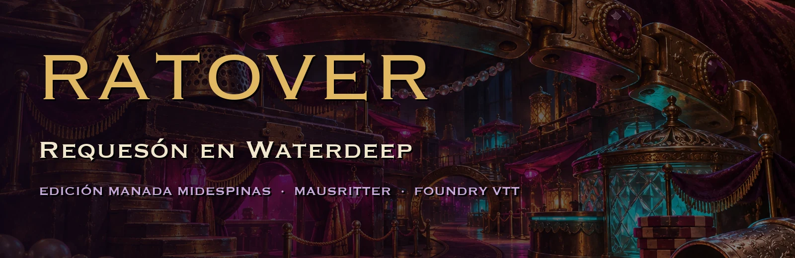

<p align="center">
  
</p>

<p align="center">
  <a href="https://github.com/ManuRomera"></a>
  <a href="https://github.com/ManuRomera/mr-requeson-waterdeep/releases/latest"></a>
  
  <a href="https://github.com/ManuRomera/mr-requeson-waterdeep/releases"></a>
  
  
  <a href="LICENSE"></a>
</p>

<h3 align="center">Cinco ratones despiertan con resaca, una desconocida que parece muerta y un baño que gruñe.<br>Y un hechizo que ya ha empezado a hacer la lista de todos los que tocaron la pulsera.</h3>

> [!IMPORTANT]
> **Necesita** el sistema **Mausritter** (`mausritter`, fork de phenomen, 0.6.1 o superior) en Foundry VTT **v13**.

## La aventura

**Ratover: Requesón en Waterdeep** es una comedia criminal de resaca para Mausritter. Anoche la Manada Midespinas recogió una pulsera robada, brindó antes de destruirla y perdió la noche entera. Esta mañana la pulsera no está, la lleva puesta una comadreja albina encadenada a la ducha, y el Ritual del Rastro Dorado va a nombrar a los cinco.

De cuatro a seis horas, o dos sesiones, para cinco jugadores. También hay una versión de dos horas (Ratover Express).

### Lo que la hace distinta

- **Cuatro frentes que se mueven solos.** Rastro Dorado, Sindicato, Rat Tyson y Acreedores avanzan un paso cada vez que el grupo pasa una escena en otro sitio.
- **Resaca narrativa.** Los jugadores declaran qué hicieron anoche. Es cierto, y lo pagan con un frente, una condición o Culpa.
- **Confesión con precio y Culpa.** Leer «Lo que temes haber hecho» ayuda al grupo y marca el epílogo de cada personaje.
- **Cinco culpables suficientes.** La jarra se contaminó con cinco acciones a la vez, y cada una bastaba por sí sola.
- **La pulsera ocupa 2x2 y solo se lleva en las patas y el cuerpo.** El módulo lo hace cumplir: un resacoso no puede cargarla solo.

## Qué incluye

| | |
|---|---|
| Escenas | 10, a pantalla completa, con miniatura y música |
| Actores | 22: 5 protagonistas, 10 PNJ y 7 genéricos, con sus inventarios colocados |
| Objetos | 48, con armas, armaduras y las 6 condiciones |
| Diarios | 38: dirección, nueve localizaciones, cinco fichas confidenciales, doce handouts y quince fotografías |
| Tablas | 8 |
| Audio | 10 pistas de escena y 8 ambientes de Kevin MacLeod (CC BY 4.0), y 6 efectos |
| Macros | 11 |

### Herramientas de mesa

El módulo añade un grupo **Requesón en Waterdeep** en la barra de herramientas de la escena.

- **Jugadores:** Pizarra de Investigación, Resaca Narrativa y Contador de Culpa.
- **Director:** además, Panel de Frentes, Avanzar a Escena (aplica la regla motor), Mostrar Handout, Presión de Princesa, El Parmesano Ruso, Fichas Confidenciales y Tirada en Tabla.

Las mismas once herramientas están como macros dentro del pack.

### Integración con MR- Dirección (opcional)

Si tienes **[MR- Dirección](https://github.com/ManuRomera/mr-direccion)** activo, la aventura se registra sola: aparecen las diez escenas con su lectura y su música, las figuras de cada una con perspectiva, ocho motivos musicales, los seis efectos de sonido y los relojes de los cuatro frentes. Sin él, todo funciona con las herramientas propias del módulo.

### Fichas, efectos y accesibilidad

- **Fichas de cuerpo entero sin fondo** (con opción de token redondo en los ajustes del mundo).
- **Efectos de sonido y destellos** en los momentos clave, con volumen propio y desactivables. Los destellos respetan la preferencia de movimiento reducido.
- **Accesibilidad:** etiquetas para lectores de pantalla, foco visible, texto grande y alto contraste opcionales.
- Las ventanas del módulo recuerdan su posición y tamaño.

## Instalación

1. En Foundry, **Instalar módulo** y pega el manifiesto:
   ```
   https://github.com/ManuRomera/mr-requeson-waterdeep/releases/latest/download/module.json
   ```
2. Activa el módulo en un mundo de Mausritter.
3. Al entrar como GM aparece **Configuración Inicial**. Pulsa Importar en la ventana de la aventura.

Los personajes se entregan **sin asignar**. Cada mesa los reparte como prefiera, y el GM da la propiedad de cada ficha confidencial con la macro Fichas Confidenciales.

## Texto de la aventura

El texto completo, en orden de lectura, está en [`aventura/AVENTURA.md`](aventura/AVENTURA.md). Los diarios del módulo se generan desde esos archivos.

## Para quien edita

- `python3 tools/build_datos.py` regenera `_data/aventura.json` desde `aventura/*.md` y `asset-manifest.json`.
- `npm run build` compila el pack y el zip.
- `asset-manifest.json` lista cada imagen y audio con su ruta y su prompt. `python3 tools/verify_assets.py` cuenta cuántos existen.
- La música son pistas de Kevin MacLeod procesadas con `tools/musica.py` (selección en `tools/musica_seleccion.json`). Los efectos son síntesis propia (`tools/audio.py`). Cualquier pista con el mismo nombre de archivo sustituye a la actual.

## Créditos y licencia

Historia y diseño: Manuel Romera Chinchilla. Módulo, herramientas, revisión de la estructura y de las reglas de mesa: Claude, bajo su dirección. Imágenes generadas con IA y firmadas con la marca MR. Música de [Kevin MacLeod](https://incompetech.com) (CC BY 4.0), con sus créditos completos en [NOTICE.md](NOTICE.md).

CC BY-NC-SA 4.0. Mausritter es de Losing Games; Waterdeep y los Reinos Olvidados, de Wizards of the Coast. Es una obra de aficionado y no oficial. Detalles en [NOTICE.md](NOTICE.md).
